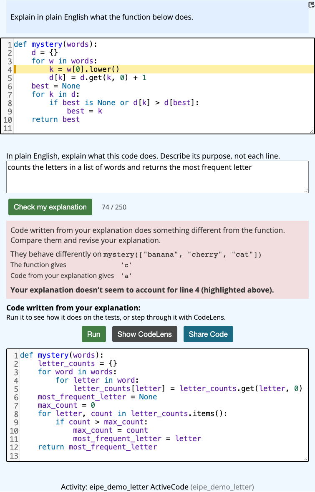
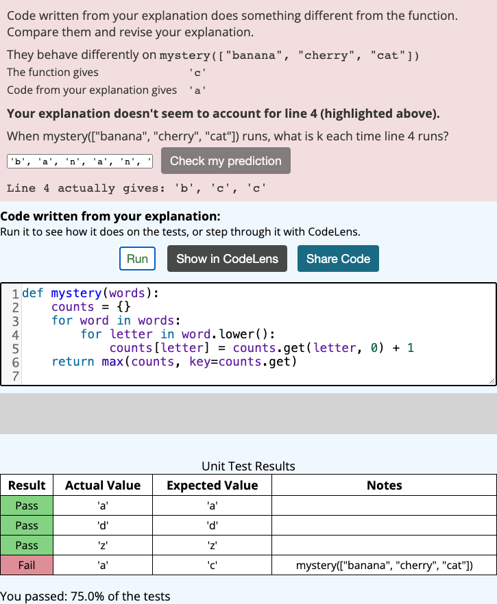
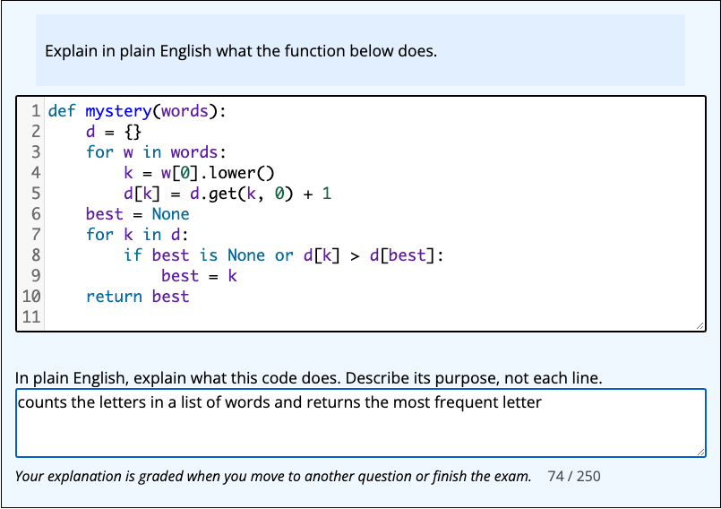

# Proposal: Explain in Plain English (EiPE) questions

**Status:** for discussion, not for merging. We'd like your decisions on the open questions below before writing the real implementation. A working prototype exists (see [Prototype](#prototype)), but there's no code to review here.

## What and why

In an Explain in Plain English question, students read a function and explain what it does in a sentence or two. It's a standard code-comprehension exercise in CS education research. It has been hard to use at scale because grading free-text explanations takes people.

**Code generation based grading** (Smith & Zilles, ITiCSE 2024, Illinois/PrairieLearn) solves the grading: an LLM writes a function from the student's explanation, and the question's unit tests decide whether that function does what the original does. Barb and I want this in Runestone for practice and for research on scaffolding code comprehension (CodeTailor's counterpart for reading code).

## What students would see

**Practice.** Students explain the function in at most 250 characters and click Check. If the explanation is wrong, they see an input where the code written from their explanation behaves differently, and the line their explanation doesn't account for is highlighted:

If they miss the same line again, they're asked to predict what that line does on that input, and then shown the real values. The values come from running the original code, not from the LLM. The code written from their explanation appears in a read-only activecode they can run against the tests (the differing input is added as a test case) and step through in CodeLens:

**Exams.** No feedback, during or after the exam: no Check button, no generated code, not even right/wrong. The explanation is graded when the student moves on or finishes. Withholding the generated code also matters for a second reason: the Illinois group found students used EiPE questions to generate code for the exam's programming questions.

## How it works

1. The student's explanation goes to the server, which first rejects ones that can't be graded: empty, over 250 characters, or code-like (e.g. `if x > y:`). No LLM call is made for those.
2. The server loads the question from the DB (the shown code and the hidden tests come from there, never from the client) and asks an LLM for a function from the explanation. This uses Smith & Zilles's prompt, `gpt-4.1-mini` at temperature 0, and the course's OpenAI token as CodeTailor does.
3. On JOBE, it runs the generated code against the question's tests, and compares it with the original on check inputs (inputs the author lists, plus the literal inputs in the tests). It passes only if both agree.
4. If it failed (practice only), a second LLM call names the line(s) the explanation missed, using the differing input as evidence. The prediction question's answer comes from tracing the original on JOBE.
5. The result is scored like an activecode run, with a `unittest` event (100% or 0%), and the full record (explanation, generated code, differing input) is kept so instructors can review grades.

**Cost per check:** a passing check makes 1 LLM call and 2 JOBE runs; a failing practice check adds a second LLM call and a third JOBE run, for the hint. Most of the plumbing already exists in CodeTailor: the token lookup, the question and data-file helpers, and the JOBE runner.

## Known limits of the grading method

- **It agrees only moderately with human graders** (Cohen's κ ≈ .58 in Smith & Zilles). The main error is passing **line-by-line** explanations, which still produce correct code. The 250-character limit and the code-like filter push against that. The method does best on code that's tedious to narrate line by line.
- **It's only as strict as the tests.** In our own testing, a wrong explanation passed until we added a check input that separated it from the right one. The comparison on check inputs exists to catch that.
- **Retries inflate wrong passes on exams.** Azad et al. (AIED 2020) found false positives went from 15% to 33% when students got three attempts with feedback, and student appeals didn't catch grading errors. That's why exams give no feedback, and why the full record is kept for instructor review.

## Decisions we'd like from you

1. **Component shape.** (a) A variant of activecode: an activecode whose textarea has `data-eipe="true"`. It reuses the editor, the tests, CodeLens, timed-exam support and activecode scoring. (b) Its own `data-component` and `question_type`.
   *We lean toward (a); the prototype does this.*
2. **Authoring.** How should authors mark EiPE questions in PreTeXt (an attribute on the program?) and in the Assignment Builder? And should the optional check inputs live in `question_json`?
3. **Where the server code lives.** The prototype adds a router, `/ns/eipe/check`, that reuses CodeTailor's private helpers in `coach.py`. Should we first move the shared pieces (activecode question helpers, OpenAI token lookup, JOBE runner) into a common module, as a no-behavior-change PR?
   *We lean toward yes, as a separate first PR.*
4. **Scoring.** Should the server write a `unittest` event through the normal logging path, so EiPE is graded exactly like activecode (`which_to_grade`, gradebook, LTI)? Or do you want a dedicated event type in the grading pipeline?
   *We lean toward `unittest`.*
5. **Where the full grading records go.** (a) `useinfo` rows written directly, because the logging endpoint keeps only 512 characters of `act`. (b) A small answer table, which would make an instructor review page easier later.
6. **When a question counts as "on an exam".** On a timed assessment in the course that isn't past due, either directly or through a selectquestion that served it to this student (from `selected_questions`). Is that the right rule? Exams run as regular assignments wouldn't be covered.
7. **LLM use.** Is it OK to use the course's OpenAI token (as CodeTailor does), with `gpt-4.1-mini` at temperature 0? (A reasoning model like CodeTailor's `gpt-5-nano` can't run at temperature 0.)

## Proposed way to land it

These are separate PRs, each reviewable on its own. Sizes come from the prototype and include tests.

| # | PR | Size |
|---|---|---|
| 1 | Move the shared CodeTailor helpers to a common module (no behavior change) | about 250 moved lines |
| 2 | Backend: grading, endpoint, scoring, records | about 800 lines + 230 test lines |
| 3 | Frontend practice UI: explanation box, results, differing input | about 350 lines + 250 test lines |
| 4 | Hints: missed-line highlight, prediction question, runnable generated code | about 300 lines + 200 test lines |
| 5 | Exams: timed version, server rule, no feedback | about 150 lines + 150 test lines |

## Prototype

A working prototype (about 2,300 lines including tests) is on [aspadiyath/rs, branch `eipe-code-generation-grading`](https://github.com/aspadiyath/rs/tree/eipe-code-generation-grading). I've tried it locally with a real course key and JOBE, in practice mode and in a timed exam that uses a selectquestion. It's there for reference, not for review. Once you've decided the questions above, I'll rebuild it to match.

## References

- Smith & Zilles, *Code Generation Based Grading: Evaluating an Auto-grading Mechanism for "Explain-in-Plain-English" Questions*, ITiCSE 2024.
- Smith et al., *Counting the Trees in the Forest: Evaluating Prompt Segmentation for Classifying Code Comprehension Level*, ITiCSE 2025.
- Denny et al., *Explaining Code with a Purpose*, ITiCSE 2024.
- Azad et al., *Strategies for Deploying Unreliable AI Graders in High-Transparency High-Stakes Exams*, AIED 2020.
- Fowler et al., *Autograding "Explain in Plain English" Questions Using NLP*, SIGCSE 2021.
